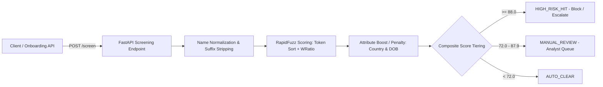

# Sanctions Screening & Fuzzy Match Entity Resolution Service

A fast, explainable FastAPI microservice for real-time sanctions and watchlist screening using multi-algorithm fuzzy name matching (`RapidFuzz`), corporate suffix normalization, and secondary attribute verification (country & date of birth).

## Architecture



## Key Features
* **Entity Normalization:** Strips punctuation and standard legal suffixes (`LLC`, `Ltd`, `Inc`, `Corp`, `Pvt`, `GmbH`, etc.) prior to comparison.
* **Hybrid Fuzzy Scoring:** Blends `token_sort_ratio` (60%) and `WRatio` (40%) across canonical names and known aliases to handle word-order shifts and typos.
* **Secondary Attribute Calibration:** Adjusts composite confidence scores based on ISO country code (`+5` / `-5`) and exact DOB (`+10` / `-10`) matches, returning transparent audit `reasons` for every hit.
* **Automated Decision Tiering:** Routes entities into `HIGH_RISK_HIT`, `MANUAL_REVIEW`, or `AUTO_CLEAR`.

## Quickstart

```bash
git clone [https://github.com/oscartandi/sanctions-entity-resolver.git](https://github.com/oscartandi/sanctions-entity-resolver.git)
cd sanctions-entity-resolver
pip install -r requirements.txt
uvicorn app.main:app --reload
```

Open `http://127.0.0.1:8000/docs` for interactive Swagger UI documentation.

## Example Request (`POST /screen`)

```json
{
  "name": "Victor Sokolov",
  "country": "RU",
  "dob": "1974-05-12"
}
```

## Running Tests

```bash
pytest -v
```
